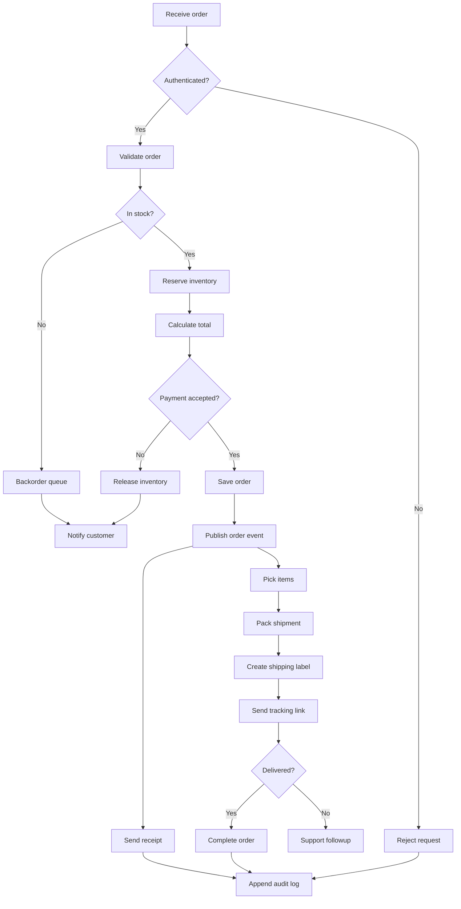
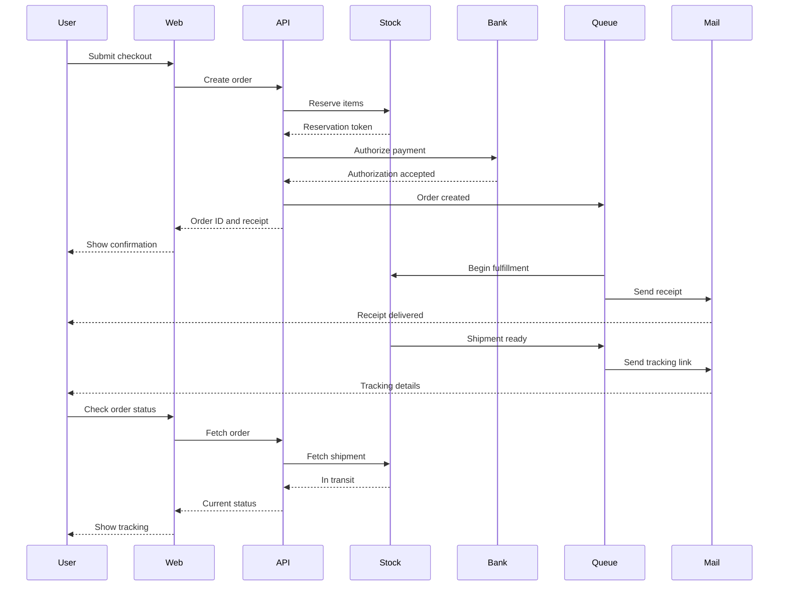
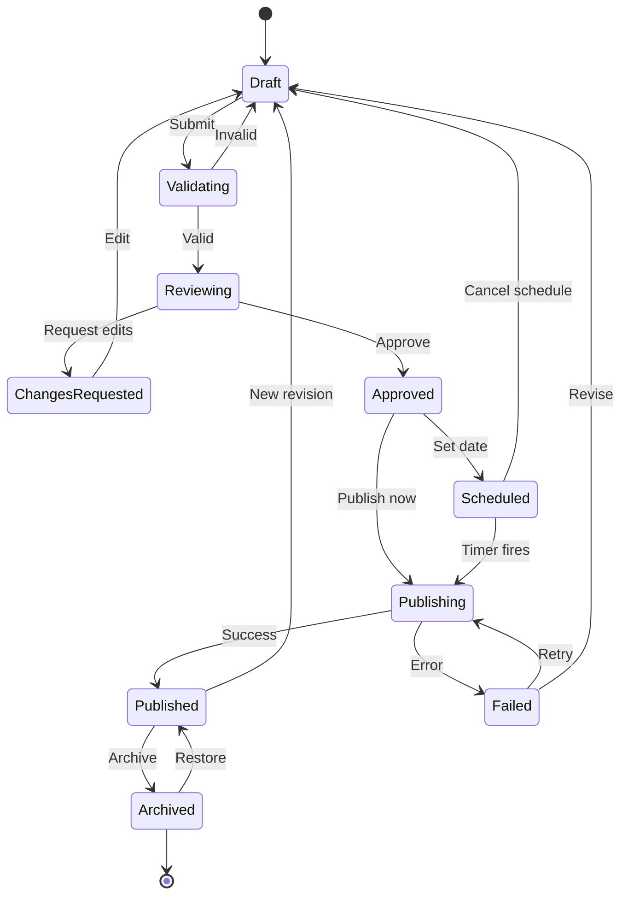
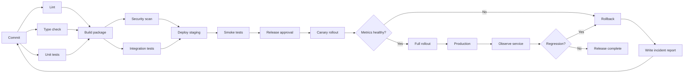

# Native Mermaid comparison

All four sections should show centered, bounded diagrams without duplicate source. These are deliberately larger than the two-node smoke test: compare branching, long edges, labels, and narrow-window readability. Click each diagram for a floating vector panel and Copy Source.

## 1. Order processing — branching flowchart

## 2. Checkout — multi-participant sequence

## 3. Document publishing — state machine

## 4. Delivery pipeline — wide flowchart

## Manual checks

- All four diagrams render centered with rounded boundaries; source is hidden by default.
- Resize narrow → wide → narrow. Check clipped arrows, label collisions, aspect ratio, and centering.
- Click each diagram. Check that its resizable panel floats over the article, with sharp labels when zoomed.
- The diagram fills the panel without a helper bar. Scroll to zoom; click-and-drag to pan. Test ⌘0, ⌘+/−, and pinch.
- Right-click the diagram and choose Copy Source. Paste into an unsaved scratch buffer and compare whitespace and line endings with the fence content.
- Reopen and dismiss with Escape, ⌘W, clicking the article, and clicking another app. Outside clicks should still work, and the article must remain open.
- Change one label in this document without saving. The preview should update.
- No pie or sequence auto-numbering is used, so the known dependency crash guards should not suppress these diagrams.
