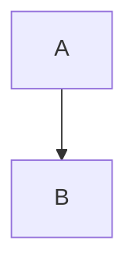

# Native Markdown preview

This is a paragraph with *emphasis*, **strong text**, ***both***, `inline code`, and an [HTTPS link](https://example.com).

## Lists

- First item
  - Nested item
- [x] Finished task
- [ ] Pending task

3. Third item
4. Fourth item

> A blockquote with **emphasis**.
>
> A second paragraph.

## Fenced code

```swift
let message = "No syntax highlighting"
print(message)
```



## Tables

| Feature | Result |
| --- | --- |
| Native text | Selectable and searchable |
| Unicode | 日本語, café, 😀 |
| A longer cell | Wraps naturally within the native table |

## Navigation

[Next document](second.md) · [Heading](#lists)


<custom>This unsupported markup stays visible, not interpreted.</custom>

$math stays readable$
